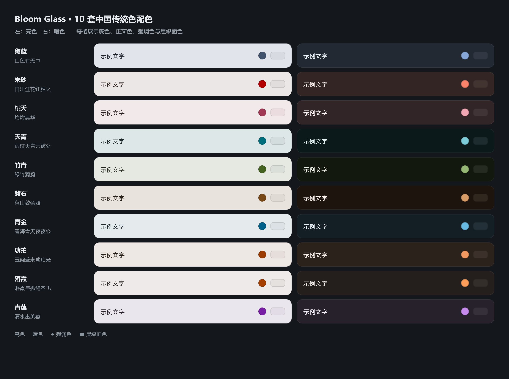
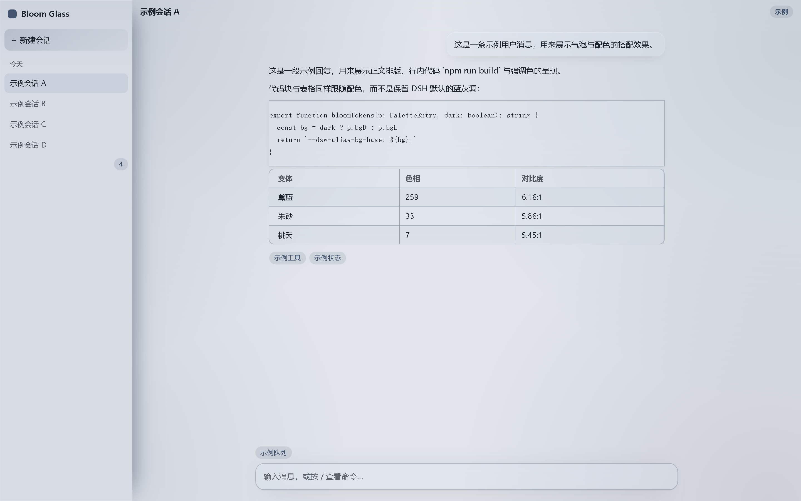
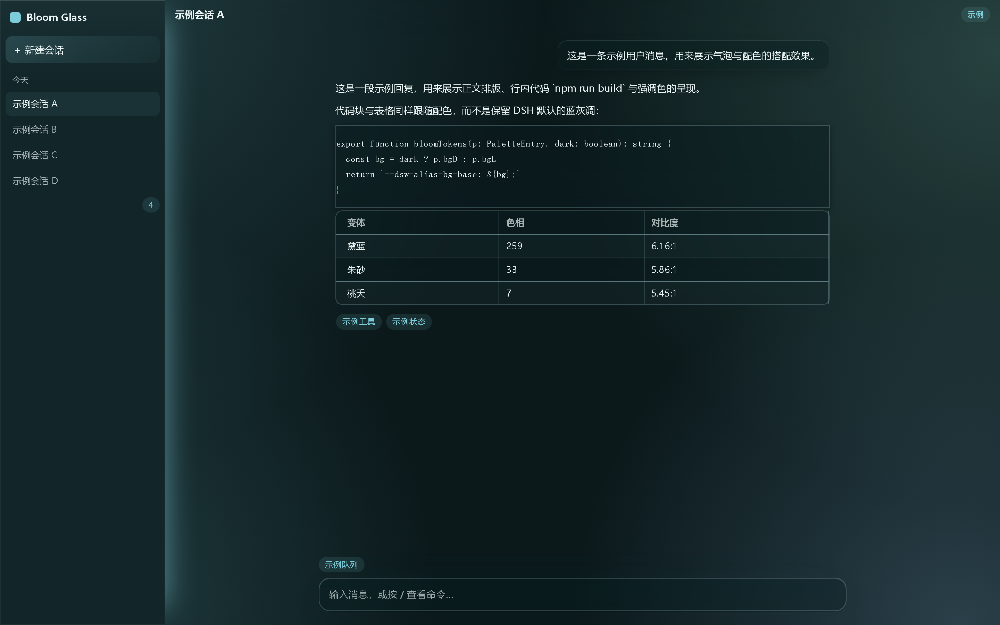
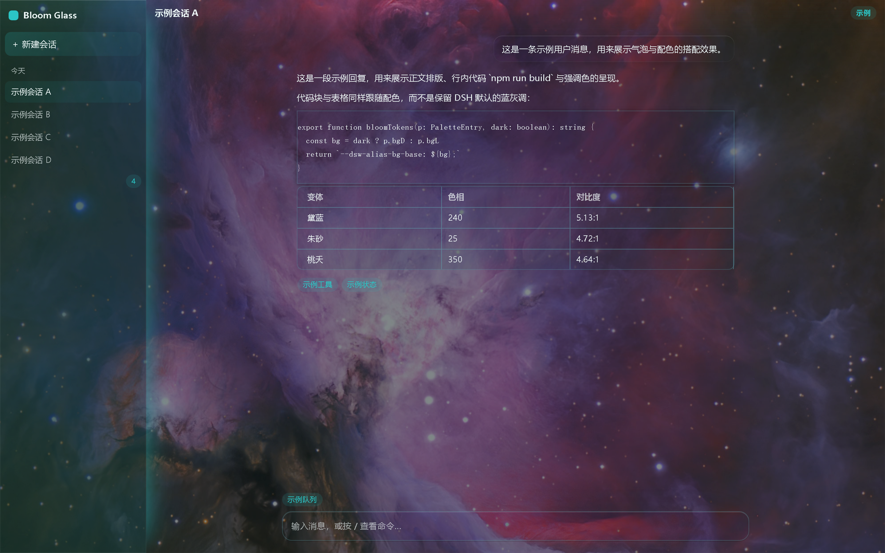
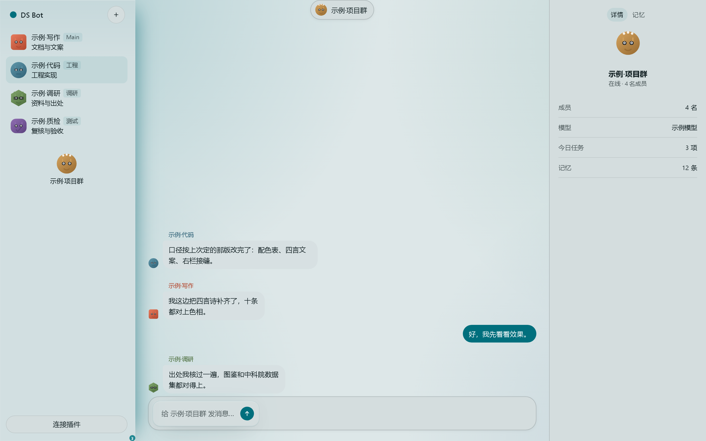
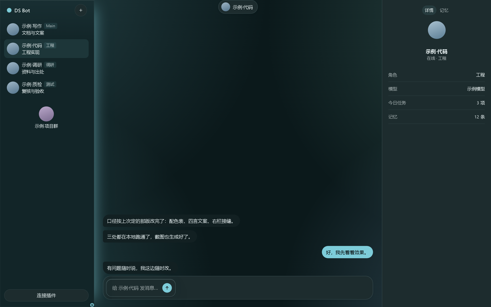

# dsh-bloomglass

一个 DeepSeek Harness Web 主题插件：十套 OKLCH 中国传统色（国色）配色打底，可选一张壁纸铺满窗口、界面以磨砂玻璃叠上去。官方 Light / Dark / System 仍然掌权。已适配 DS Bot（Bot 团队）界面。

## 效果展示

10 套配色，每套都有亮色与暗色（底色 / 正文色 / 强调色 / 层级面色）：



| 亮色 · 黛蓝 | 暗色 · 天青 |
| --- | --- |
|  |  |

同一配色与窗口，只多了壁纸层 —— 表面色按玻璃浓度转为半透明，文字与边框保持不透明：



## 功能

- **10 套配色**：黛蓝 / 朱砂 / 桃夭 / 天青 / 竹青 / 赭石 / 青金 / 琥珀 / 落霞 / 青莲，明暗自适应
- **DS Bot（Bot 团队）适配**：Bot 侧栏与分组、对话气泡、输入卡片、详情面板、菜单与对话框都跟随当前配色；铺了壁纸时，浮在壁纸上的面板 / 菜单 / 对话框按玻璃层级转半透明并加背景模糊
- **token 优先权**：ds-bot 也写的 6 个 DSH token，本主题会在它注册之后重新压回自己的值，整窗只留一套配色
- **壁纸 + 磨砂**：本地 JPEG / PNG / WebP / GIF，无大小限制
- **磨砂范围**：左侧栏、会话区、右侧栏（含全屏展开）、设置弹窗，以及 DS Bot 的固定面板与弹层
- **一个独立设置栏**：设置 → Bloom Glass，含配色选择 + 玻璃浓度 / 模糊 / 饱和 / 压暗滑杆 + 保存 / 删除，不往「通用」页插行
- 壁纸关闭时是纯配色模式；打开后表面色按玻璃浓度转为半透明（文字与边框始终不透明）
- 只走官方 `overrideTokens` 覆盖层，从不 `setTheme('custom')`；不写 `settings.yaml`，不请求任何远程 URL

数据位置：壁纸存 IndexedDB，旋钮存 `localStorage`。

### DS Bot（Bot 团队）界面

Bot 列表、对话气泡、输入卡片与右侧详情面板都跟随当前配色与明暗（下图为亮 / 暗两态；截图里的 Bot 名、会话与面板内容全部为虚构示例。整页用 ds-bot 自己的样式表与头像代码合成，不含任何真实会话，也不含任何真实头像图片）：

| 亮色 | 暗色 |
| --- | --- |
|  |  |

- **配色与明暗跟随**：Bot 侧栏与分组、对话气泡、输入卡片、详情面板、菜单与对话框都跟当前配色和明暗走；ds-bot 自带的「设置 → 外观 → 主题 / 强调色」对 Bot 界面不再生效。
- **壁纸下的玻璃**：浮在壁纸上的面板、菜单与对话框按玻璃层级转半透明并加背景模糊；Bot↔Bot 会话层用更厚的底板，保证盖得住下层正在读的对话。
- **用户侧同色**：用户气泡与输入框右侧的发送按钮取同一组颜色（引用而非抄值），换配色或明暗时一起变。
- **输入栏只一条光标**：聚焦时不再在光标旁叠出第二条竖线。

## 安装

`dsh web` 需已在运行。

```sh
# 从 npm 安装
dsh plugin --profile web add dsh-bloomglass

# 或直接从仓库安装
dsh plugin --profile web add github:CosmoSail/dsh-bloomglass
```

装完**重启 `dsh web`**（刷新页面不够），然后打开 **设置 → Bloom Glass**。

首次启动会一次性读取旧版插件留下的三个位置——`localStorage` 的 `dsh-bloom-variant`（配色）、`dsh-frosted-window:knobs`（玻璃参数），以及名为 `dsh-frosted-window` 的 IndexedDB 库里的壁纸——把先前保存的选择接过来。之后写入的是本插件自己的键，不再回读。

## 开发

```sh
git clone https://github.com/CosmoSail/dsh-bloomglass.git
cd dsh-bloomglass
npm install
npm test         # vitest，115 个用例
npm run typecheck
npm run build    # tsdown → lib/index.js + lib/client.js
npm run showcase # 重新生成 docs/showcase 下的演示页
npm run showcase:bot # 重新生成 DS Bot 界面演示页（需已安装 ds-bot）
```

`lib/` 随仓库提交（`dsh plugin add github:` 依赖它，也免去用户本地构建），因此**改完源码请重新构建再提交**。

契约：按官方 [package-and-install](https://github.com/deepseek-ai/deepseek-harness/blob/master/docs/user/develop/basic/publish.md) 以 `dsh.bundle` + `dsh.client` 分发。

## 许可

MIT，见 [LICENSE](LICENSE)。
